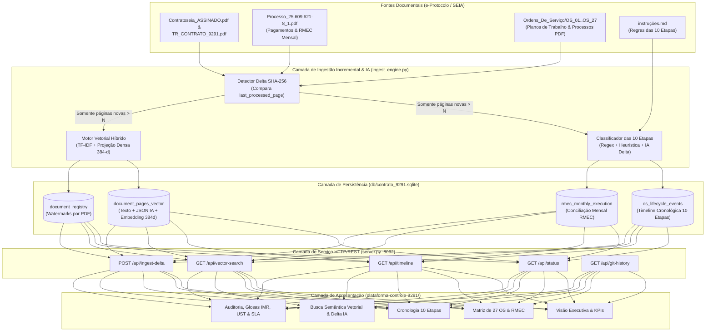

# 🌐 Especificação do Sistema — Plataforma de Controle e Auditoria do Contrato 9291/2025

> **Versão:** 1.3.0  
> **Data:** Outubro de 2026  
> **Status:** Ativo / Produção  
> **Repositório:** `jacirjl/controle-contratos-9291`  
> **Metodologia:** SDD / Spec-Kit (Fonte Única de Verdade)

---

## 1. Visão Geral e Propósito

A **Plataforma de Controle e Auditoria do Contrato 9291/2025** é uma solução de engenharia de software e inteligência de auditoria contratual desenvolvida para fiscalização, conciliação físico-financeira e rastreabilidade cronológica do **Contrato nº 9291/2025** (Protocolo Base `24.574.062-0`), firmado entre a **Secretaria da Inovação e Inteligência Artificial do Paraná (SEIA-PR)** e o **Consórcio SENAI-FUNPAR** no valor global de **R$ 74.668.400,00** (380.000 USTs a R$ 196,50/UST).

### Objetivos Principais:
1. **Conferência Plano de Trabalho $\times$ Execução $\times$ Cobrança:** Auditar todas as **27 Ordens de Serviço (OS 01 a OS 27)** confrontando artefatos planejados, relatórios mensais de execução (RMEC), termos de aceite, notas fiscais e liquidações no SIGA.
2. **Rastreabilidade Cronológica de 10 Etapas (`instruções.md`):** Manter uma linha do tempo imutável e ordenada cronologicamente para cada OS, cobrindo da etapa `1. Solicitação de Plano de Trabalho` até `10. Pagamento`, cruzada com o processo de pagamento `Processo_25.609.621-8_1.pdf`.
3. **Banco Vetorial Híbrido com Ingestão Incremental (*Append-Only Delta*):** Indexar todos os documentos PDF do e-Protocolo em um banco SQLite vetorial local (`db/contrato_9291.sqlite`) com vetores semânticos densos (384 dimensões) e marca d'água criptográfica SHA-256 por página, garantindo que **atualizações de PDFs processem exclusivamente as páginas novas adicionadas ao final**, economizando 100% dos tokens de IA sobre páginas históricas.
4. **Governança SDD e Reversibilidade Git/GitHub:** Registrar todas as especificações e mudanças sob o método Spec-Driven Development (SDD), com versionamento atômico em Git/GitHub e reversão rápida.

---

## 2. Arquitetura da Solução

---

## 3. Estrutura do Projeto

| Arquivo / Diretório | Responsabilidade |
| :--- | :--- |
| [`ingest_engine.py`](file:///c:/ProgsAntigravity/Contratos/ingest_engine.py) | Motor de ingestão incremental (*Append-Only Delta*), extração cronológica das 10 etapas, conciliação RMEC e busca semântica vetorial. |
| [`server.py`](file:///c:/ProgsAntigravity/Contratos/server.py) | Servidor HTTP/REST multi-thread na porta `8092` que serve a aplicação web e expõe os endpoints de banco vetorial, linha do tempo e ingestão delta. |
| [`db/contrato_9291.sqlite`](file:///c:/ProgsAntigravity/Contratos/db/contrato_9291.sqlite) | Banco de dados híbrido (Event-Store Relacional + Vector Store 384-d) com suporte a WAL e watermarks SHA-256. |
| [`plataforma-controle-9291/index.html`](file:///c:/ProgsAntigravity/Contratos/plataforma-controle-9291/index.html) | Estrutura principal da interface web responsiva com 9 módulos de controle e auditoria contratual. |
| [`plataforma-controle-9291/js/data.js`](file:///c:/ProgsAntigravity/Contratos/plataforma-controle-9291/js/data.js) | Dataset auditado completo do Contrato 9291/2025, 27 Ordens de Serviço, catálogo de 40 itens UST, 14 achados de auditoria, cronologia e RMEC. |
| [`plataforma-controle-9291/js/app.js`](file:///c:/ProgsAntigravity/Contratos/plataforma-controle-9291/js/app.js) | Controlador frontend de estados, filtros, gráficos Chart.js, simuladores IMR/UST/SLA e integração assíncrona com a API REST (`server.py`). |
| [`plataforma-controle-9291/css/styles.css`](file:///c:/ProgsAntigravity/Contratos/plataforma-controle-9291/css/styles.css) | Sistema de design *Enterprise Dark Glassmorphism* otimizado para leitura densa de auditoria e impressão. |
| [`instruções.md`](file:///c:/ProgsAntigravity/Contratos/instruções.md) | Regra de negócio base definindo o fluxo de checagem documental em 10 etapas e conciliação com o processo de pagamento. |
| [`specs/`](file:///c:/ProgsAntigravity/Contratos/specs) | Especificações formais SDD (Spec-Kit) de todos os módulos e registro de rastreabilidade Git. |
| [`iniciar_plataforma.bat`](file:///c:/ProgsAntigravity/Contratos/iniciar_plataforma.bat) | Script de inicialização rápida que libera a porta `8092`, inicia o servidor Python e abre o navegador. |
| [`backup.bat`](file:///c:/ProgsAntigravity/Contratos/backup.bat) | Utilitário CLI para commit e sincronização imediata com o GitHub (`origin main`). |
| [`reverter.bat`](file:///c:/ProgsAntigravity/Contratos/reverter.bat) | Utilitário interativo para reversão segura de alterações via tags SDD ou commits Git. |

---

## 4. Módulos Técnicos e Especificações Detalhadas

O sistema é dividido em 5 especificações formais na pasta [`specs/`](file:///c:/ProgsAntigravity/Contratos/specs):

1. **Persistência Híbrida Relacional + Vetorial ([`specs/01-database-schema.spec.md`](./01-database-schema.spec.md)):** Modelo de dados SQLite (`PRAGMA journal_mode=WAL`), controle de watermarks por arquivo/página, eventos cronológicos e vetores semânticos `FLOAT32[384]`.
2. **Motor de Ingestão Incremental & Busca Semântica ([`specs/02-delta-ingestion-engine.spec.md`](./02-delta-ingestion-engine.spec.md)):** Algoritmo *Append-Only Delta* que lê apenas ` páginas > last_processed_page`, valida a integridade com hash SHA-256 na fronteira e extrai eventos das 10 etapas.
3. **Servidor API HTTP/REST ([`specs/03-api-server.spec.md`](./03-api-server.spec.md)):** Camada de comunicação REST entre a interface web e o motor Python/SQLite.
4. **Plataforma Web de Auditoria e Controle UI/UX ([`specs/04-audit-control-platform.spec.md`](./04-audit-control-platform.spec.md)):** Painéis executivos, matriz de 27 OS, linha do tempo de 10 etapas, buscador vetorial em tempo real e calculadoras de glosa IMR/UST/SLA.
5. **Rastreabilidade SDD e Reversibilidade Git ([`specs/05-sdd-changelog-reversibilidade.spec.md`](./05-sdd-changelog-reversibilidade.spec.md)):** Histórico completo de versões, tags Git e procedimentos de rollback.

---

## 5. Requisitos Não-Funcionais e Diretrizes

1. **Economia Estrita de Tokens de IA (Zero Re-Ingestão):** Documentos do e-Protocolo são *append-only* (novas peças são anexadas ao final sem alterar páginas anteriores). O sistema jamais reprocessa páginas `1..N` já salvas quando o hash SHA-256 da página `N` permanece idêntico.
2. **Disponibilidade Cronológica Permanente:** Todos os eventos extraídos são persistidos em `os_lifecycle_events` com ordenação determinística por `(data_evento_iso ASC, etapa_num ASC, page_number ASC)` e exportados também para `plataforma-controle-9291/js/data.js` para funcionamento *offline-first*.
3. **Reversibilidade Total (Git + SDD):** Toda alteração de código é encapsulada em commits atômicos referenciando a respectiva especificação SDD, permitindo rollback não-destrutivo a qualquer versão anterior.
